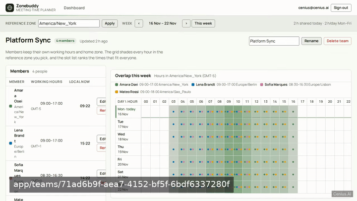
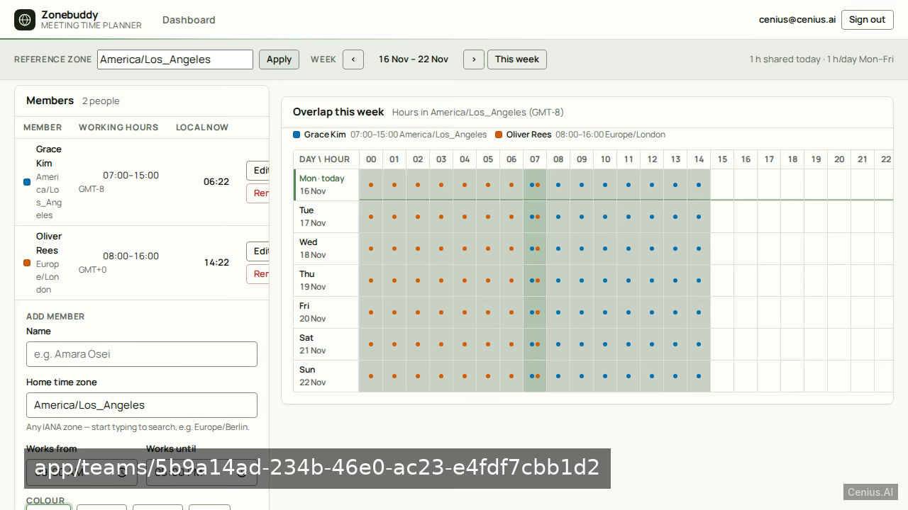
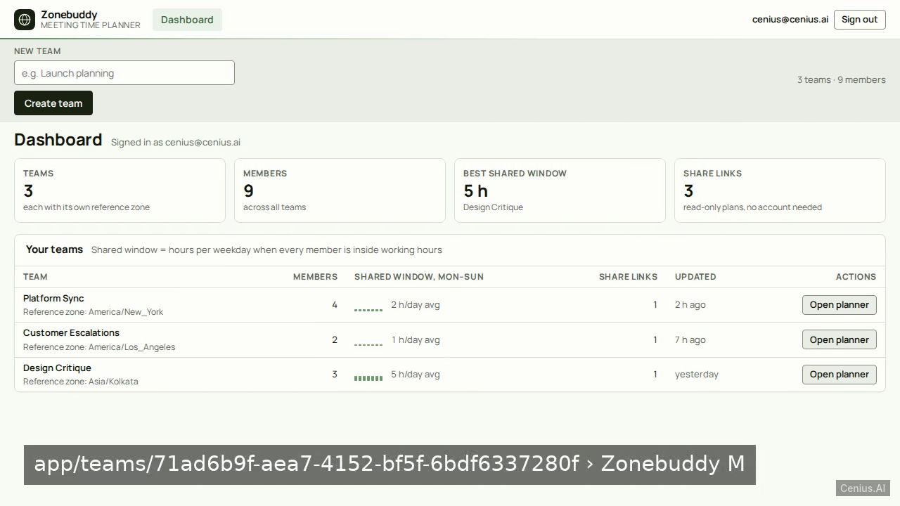
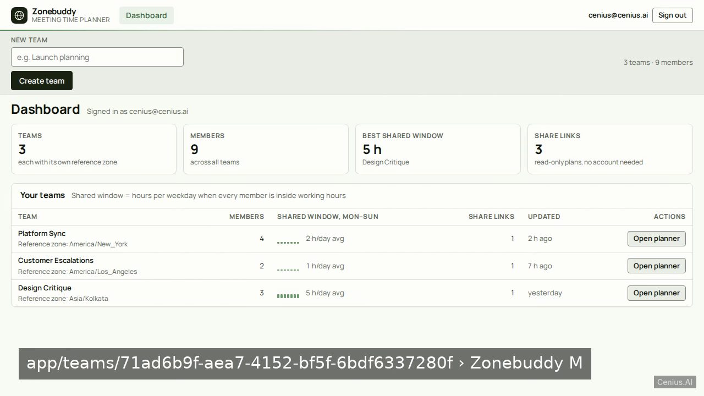

# Zonebuddy Meeting Time Planner — complete Node.js appointment scheduling system example app

Zonebuddy is a full-stack web app for distributed teams who need to find a meeting hour that fits everyone. That's **Zonebuddy Meeting Time Planner** — a Apache-2.0-licensed, open-source appointment scheduling system in Node.js you can self-host and modify freely. Fork Zonebuddy Meeting Time Planner, run it, or [remix it on cenius.ai](https://cenius.ai/marketplace/p/zonebuddy-meeting-time-planner?ref=gh&utm_campaign=zonebuddy-meeting-time-planner-nodejs) for a custom Zonebuddy Meeting Time Planner build with full rebrand rights.


[](LICENSE)  [](https://cenius.ai)

[](https://cenius.ai/marketplace/p/zonebuddy-meeting-time-planner?ref=gh&utm_campaign=zonebuddy-meeting-time-planner-nodejs)

> **▶ [Open & edit in cenius.ai](https://cenius.ai/marketplace/p/zonebuddy-meeting-time-planner?ref=gh&utm_campaign=zonebuddy-meeting-time-planner-nodejs)** — one click to an editable workspace: describe changes in plain English, get an instant preview, one-click deploy and host. Modifications made on the platform come with full rebrand & relicense rights.

_Local clone? See [Quick start](#quick-start) below. cenius.ai is the zero-setup path._

## Demo



📽 **[Demo video on cenius.ai](https://cenius.ai/marketplace/p/zonebuddy-meeting-time-planner?ref=gh&utm_campaign=zonebuddy-meeting-time-planner-nodejs)** — the complete run-through · [MP4](.github/media/demo.mp4)

## Screenshots

  

## Quick start

```bash
./install.sh   # installs dependencies + seeds demo data
```

See [`INSTALL.md`](INSTALL.md) for full setup and usage instructions.

## Features

- Email/password auth with a visible demo account
- Teams dashboard
- Team members with home time zones
- Overlapping working-hours grid
- Meeting slot suggestions
- Shareable plan links

## Architecture

Folder layout: `data/`, `public/`, `test/`. Dependency management and data seeding are both handled by `./install.sh` — run it once, then start the server. Built in Node.js (29 files). For environment-specific setup, see [`INSTALL.md`](INSTALL.md).

## Usage guide

A five-minute walkthrough of everything the app does.

### Sign in

Open `/login`. The card prints the demo credential (`cenius@cenius.ai` / `cenius`) and a
**Fill demo credentials** button; the eye button toggles the password. A wrong password produces a
single non-committal message — the form never reveals whether the address exists.

`/signup` creates a real account (email, password ≥ 8 characters, confirmation). Field errors
appear under each input and are announced through an `aria-live` region.

### Dashboard (`/app`)

- Four summary tiles: number of teams, total members, the best shared window this week, and how
  many read-only links exist.
- A dense table of your teams: member count, a Mon–Sun sparkline of shared hours per day, share-link
  count, last update, and an **Open planner** link.
- The sticky bar above the table holds the **New team** form: type a name, press **Create team**,
  and you land directly in the new team's planner.

### Team planner (`/app/teams/:id`)

**Members panel** — each row shows the member's colour, home zone, working hours and their current
local time (refreshed each minute). **Edit** fills the form with that member; **Remove** asks for
confirmation inline.

The form below adds a member: name, home time zone (type to search 400+ IANA zones, or keep the
prefilled value), start and end of the working day, and a colour from the six-series palette.
Validation runs on submit and is mirrored by the server: a missing name, an unknown zone, or an
end time at/before the start time comes back as a field-level message and nothing is saved.

_Full guide: [`USAGE.md`](USAGE.md)_

## FAQ

### How do I get Zonebuddy Meeting Time Planner running locally?

Everything you need ships in this repo: clone it, run `./install.sh` to install dependencies and seed demo data, then follow [`INSTALL.md`](INSTALL.md) to start it. No external services required.

### Can I change Zonebuddy Meeting Time Planner without writing code?

The easiest route: [visit the project on cenius.ai](https://cenius.ai/marketplace/p/zonebuddy-meeting-time-planner?ref=gh&utm_campaign=zonebuddy-meeting-time-planner-nodejs), tell the platform what to change, and collect the updated build. No source-editing needed.

### Which technology stack does Zonebuddy Meeting Time Planner use?

Zonebuddy Meeting Time Planner is a Node.js application — and this repository holds the complete, runnable source, not a stripped-down sample. Highlights include teams dashboard.

### Is it OK to ship Zonebuddy Meeting Time Planner as part of a product?

It is. Apache-2.0 licensing means you can build a product on it, sell it, or use it inside a company with no fees. Details: [LICENSE](LICENSE).

### Is it possible to white-label Zonebuddy Meeting Time Planner for a client?

Yes. You can edit the source directly under the MIT license, or [remix it on cenius.ai](https://cenius.ai/marketplace/p/zonebuddy-meeting-time-planner?ref=gh&utm_campaign=zonebuddy-meeting-time-planner-nodejs) — the platform route grants full rebrand and relicense rights over your derivative.

## License & rebranding

Released under the [Apache License 2.0](LICENSE) (© 2026 Cenius AI) — free for personal and commercial use. The Cenius name/logo are trademarks (see NOTICE).

**Need a customized version?** [Remix this app on cenius.ai](https://cenius.ai/marketplace/p/zonebuddy-meeting-time-planner?ref=gh&utm_campaign=zonebuddy-meeting-time-planner-nodejs) — modifications made on the platform come with **full rebrand & relicense rights** over your derivative.

## Built with cenius.ai

This entire application — code, design, seeded demo data — was generated on **[cenius.ai](https://cenius.ai)** from a plain-English description.

- 🚀 [Build your own app on cenius.ai](https://cenius.ai)
- 🎛️ [Remix Zonebuddy Meeting Time Planner on the marketplace](https://cenius.ai/marketplace/p/zonebuddy-meeting-time-planner?ref=gh&utm_campaign=zonebuddy-meeting-time-planner-nodejs) — open it in a workspace, prompt for changes, and ship your own version.

More open-source apps: [the Cenius-ai catalog](https://github.com/Cenius-ai) · [showcase index](https://github.com/Cenius-ai/showcase)
